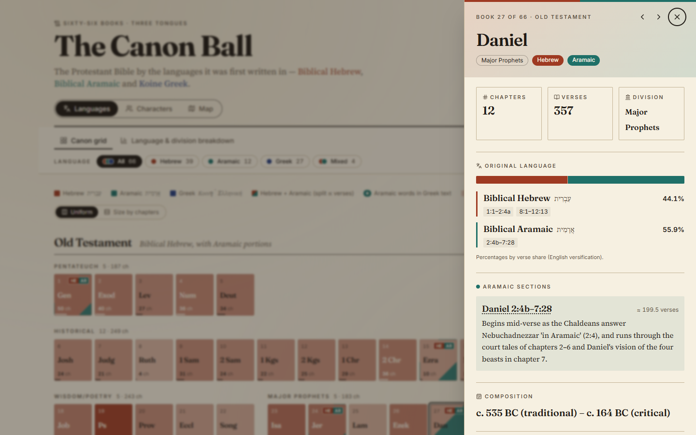
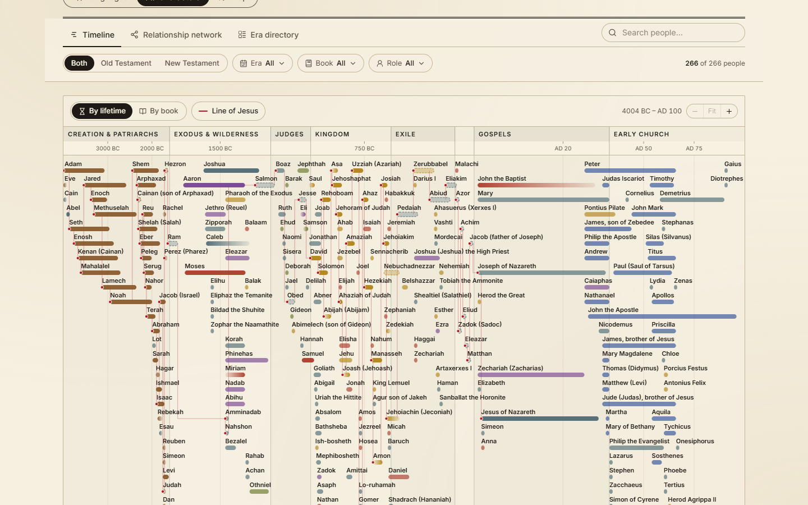
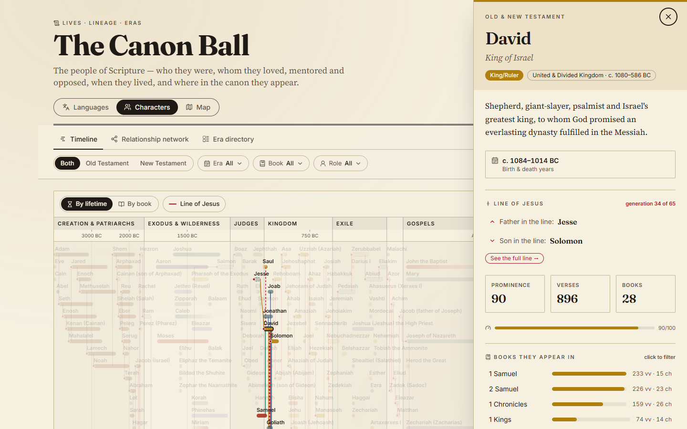
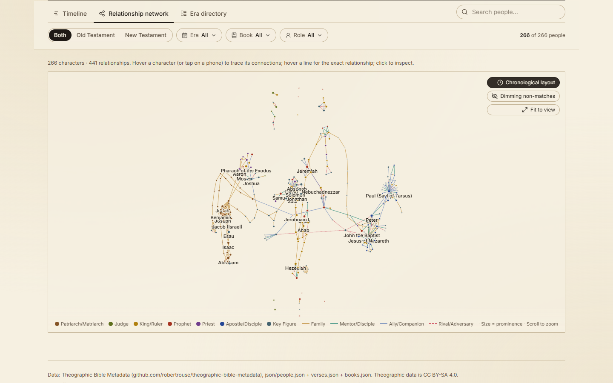
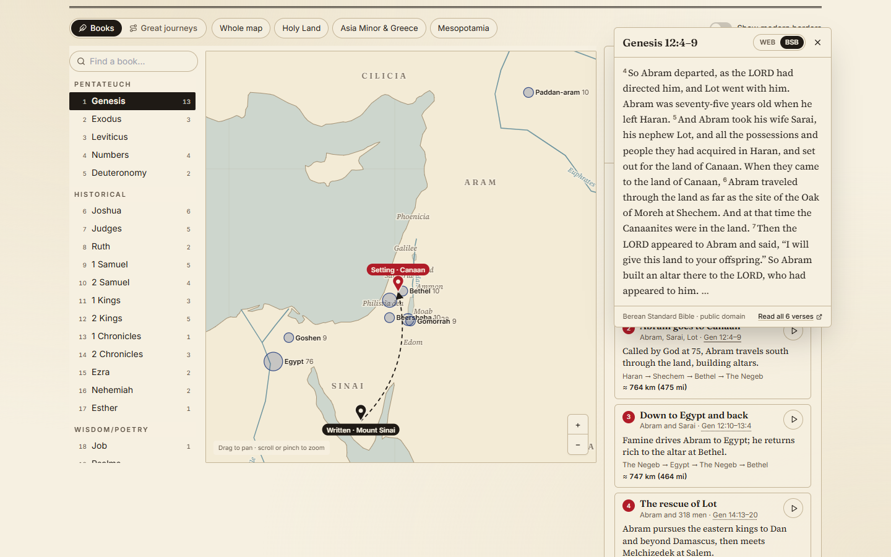
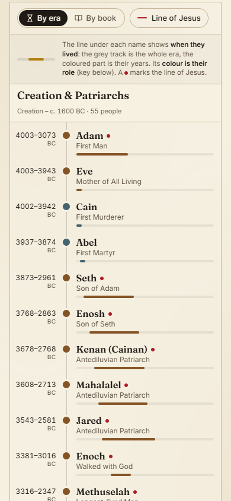

# The Canon Ball

**An interactive guide to the Bible's languages, people and places.**

**▶ Open the site: https://work-kelv.github.io/the-canon-ball/**

It works on phones and computers, in light or dark mode. You can share a link to any page, book or person.


The site has three pages:

| Page | What you can explore |
|---|---|
| **[Languages](https://work-kelv.github.io/the-canon-ball/)** | All 66 books and the language each was written in: Hebrew, Aramaic or Koine Greek. |
| **[Characters](https://work-kelv.github.io/the-canon-ball/characters.html)** | 266 people on one timeline: when they lived, how they are related, and Jesus' line from Adam. |
| **[Map](https://work-kelv.github.io/the-canon-ball/map.html)** | Where each book was written and set, and 129 journeys you can watch on the map. |

Any Bible reference on the site (shown with a dotted underline) can be clicked to read the verses. You can switch between two translations, the **World English Bible** and the **Berean Standard Bible**.

---

## 1. Languages

All 66 books are shown in canonical order. Each one is coloured by its original language, and stronger colour means more chapters.

- **Hebrew and Aramaic books.** Ezra and Daniel are split diagonally to show how much of each is in Aramaic. Genesis and Jeremiah, which have only a few Aramaic words, are marked with a small corner.
- **Book details.** Click any book to see its exact Aramaic passages (for example Daniel 2:4b–7:28), its chapter and verse counts, when it was likely written, and why it used that language.
- **Breakdown.** A second view filters the books by language and shows how the chapters divide between languages and between parts of the Bible.

| Book detail (Daniel) | Breakdown in dark mode |
|---|---|
|  |  |

## 2. Characters

There are 266 people, from Adam to the early church. The list includes everyone mentioned in the five books that had no characters before (Jonah, Nahum, Habakkuk, Haggai and 3 John), Jacob's twelve sons, and a per-book checklist of prominent figures.



- **Timeline.** Everyone is placed on one time axis. You can arrange people by when they lived or by book; "By book" puts Ezra and Nehemiah together, for example. Move your mouse across the timeline to see who was alive in a given year.
- **Line of Jesus.** A red line traces all 65 generations from Adam to Jesus.
- **Filters.** Narrow the list by Old or New Testament, era, book, role, or a name search. The timeline zooms to fit whoever is left.
- **Person page.** Click anyone to see a short biography, their dates and how certain they are, which books they appear in, and their relationships. You can jump straight to a related person.
- **Relationship network.** A web of 441 family, mentor, ally and rival relationships.

| Person page (David) | Relationship network |
|---|---|
|  |  |

## 3. Map

The map covers the Mediterranean and the Ancient Near East, drawn in a parchment style with ancient region names. A switch shows modern borders.


- **Books.** Choose any of the 66 books. The map shows where it was likely written, where it is set (or where the letter was sent), and the places it names most often.
- **Journeys in every book.** There are 129 journeys in total; Genesis alone has 13.
  - Each one lists who travelled, the Bible reference, the stops and the distance.
  - Press ▶ to watch it play on the map, or **Play all** to see the journeys one after another.
  - The map stays at the top of the screen while you scroll down the list.
- **Great journeys.** Five major routes, each with a short history:
  - Abraham's journey
  - The Exodus
  - The Babylonian exile and return
  - Jesus' ministry
  - Paul's three missionary journeys and his voyage to Rome
- **Place details.** Click any place to see its modern site and country, a note from Easton's Bible Dictionary, the books that mention it, and the people connected with it.

| Great journeys (Paul's 2nd journey) | Click a reference to read it |
|---|---|
|  |  |

## On a phone

On a phone the timeline turns vertical, and the map stays pinned to the top while you read.

| Timeline | Map |
|---|---|
|  |  |

---

## Sources

Each page ends with its own reference list. Wikipedia is not used as a source; the site relies on the primary texts and the datasets below.

| Source | Used for | Licence |
|---|---|---|
| [Theographic Bible Metadata](https://github.com/robertrouse/theographic-bible-metadata) | People, family links, places, and the verses they appear in | CC BY-SA 4.0 |
| [OpenBible.info Geocoding](https://www.openbible.info/geo/) | Modern names for ancient sites | CC BY 4.0 |
| [World English Bible and Berean Standard Bible](https://github.com/seven1m/open-bibles) | The verse text in the pop-ups | Public domain |
| [Sefaria](https://www.sefaria.org/texts/Tanakh) and the [SBL Greek New Testament](https://sblgnt.com/) | The Hebrew and Aramaic passages and Greek words cited on the Languages page | — |
| [Pleiades](https://pleiades.stoa.org/) | Gazetteer links on place cards | — |
| [Natural Earth](https://www.naturalearthdata.com/), via [world-atlas](https://github.com/topojson/world-atlas) | Coastlines and modern borders | Public domain |
| [Bible-kjv](https://github.com/aruljohn/Bible-kjv) | Book order and chapter and verse counts | — |

**Notes on accuracy**
- **Dates.** The dates come from Theographic, which largely follows Archbishop Ussher's 17th-century chronology (Creation in 4004 BC). Modern scholars date many events differently.
- **Uncertain dates and places.** Where a date or location is uncertain, the site says so.
- **Editorial content.** Character summaries, where each book was written and set, the journey routes and the journey histories were written for this site, and their notes flag debated points.
- **Distances.** Distances are straight lines between stops. The roads and sea routes actually travelled were longer.
- **Licence of the data files.** The data files built from Theographic (`src/data/biblicalCharacters.json` and `src/data/bibleGeography.json`) are shared under the same CC BY-SA 4.0 licence.

---

## For developers

Built with React, TypeScript, Vite, Tailwind CSS, d3-geo/d3-zoom, react-force-graph-2d and Lucide icons.

```bash
npm install
npm run dev        # http://localhost:5173  (index.html, characters.html, map.html)
npm run build      # type-check + production build into dist/
```

Every push to `main` is published to GitHub Pages by [.github/workflows/deploy.yml](.github/workflows/deploy.yml).

### Rebuilding the data

The JSON files in `src/data/` are generated from the open datasets listed above. Those downloads (about 80 MB) are not kept in the repository.

```bash
# Characters (needs Theographic people.json, verses.json, books.json)
node scripts/characters/build-characters.cjs <theographic-json-dir> src/data/biblicalCharacters.json

# Map (also needs places.json, plus OpenBible's ancient.jsonl)
node scripts/geography/build-geography.mjs <theographic-json-dir> <openbible-data-dir>

# Verse text (WEB and BSB USFX files from seven1m/open-bibles)
node scripts/scripture/build-scripture.mjs eng-web.usfx.xml eng-bsb.usfx.xml
```

The hand-written parts (summaries, relationships, journeys and journey histories) are in `scripts/characters/curated*.cjs` and `scripts/geography/curated*.mjs`.

### Project layout

```
index.html · characters.html · map.html   three pages, each with its own entry in src/
src/App.tsx                               shared header, navigation, theme and references
src/components/                           Languages page
src/components/characters/                timeline, network, directory, person page
src/components/map/                       map, journey animation, book and journey panels
src/components/ScriptureRef.tsx           clickable references with WEB / BSB pop-ups
src/data/                                 generated datasets
scripts/                                  data build scripts and curated content
data-sources/                             per-book character checklist
```
