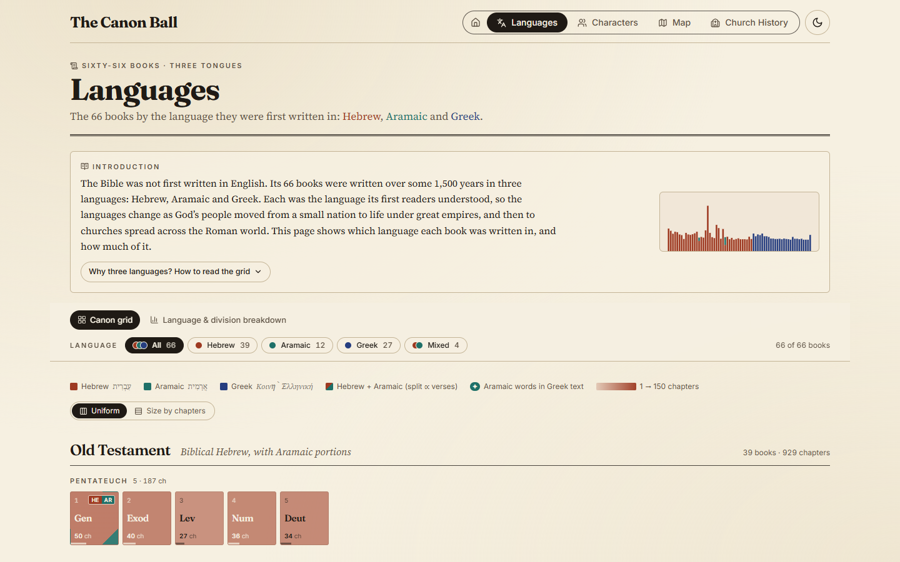
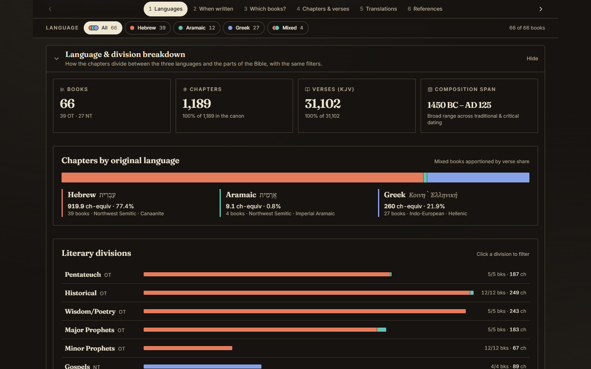
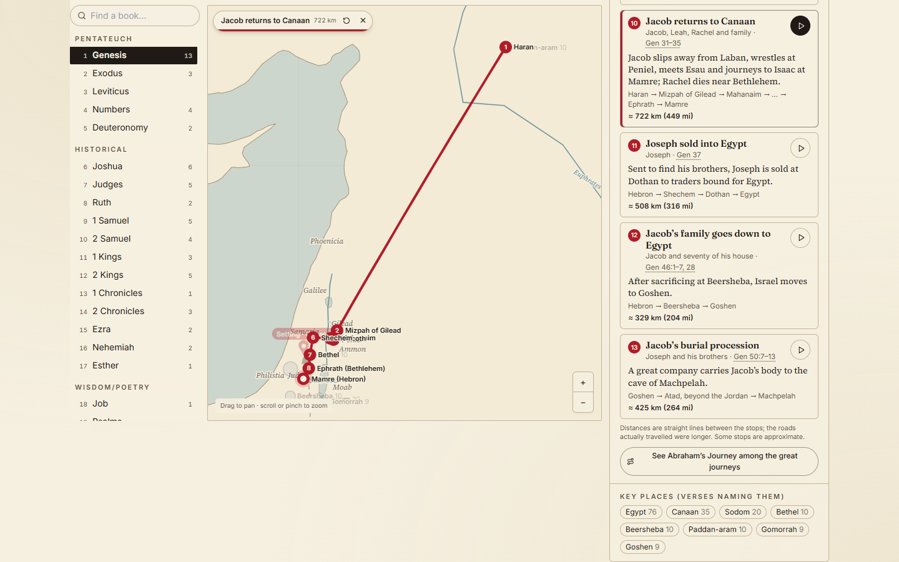
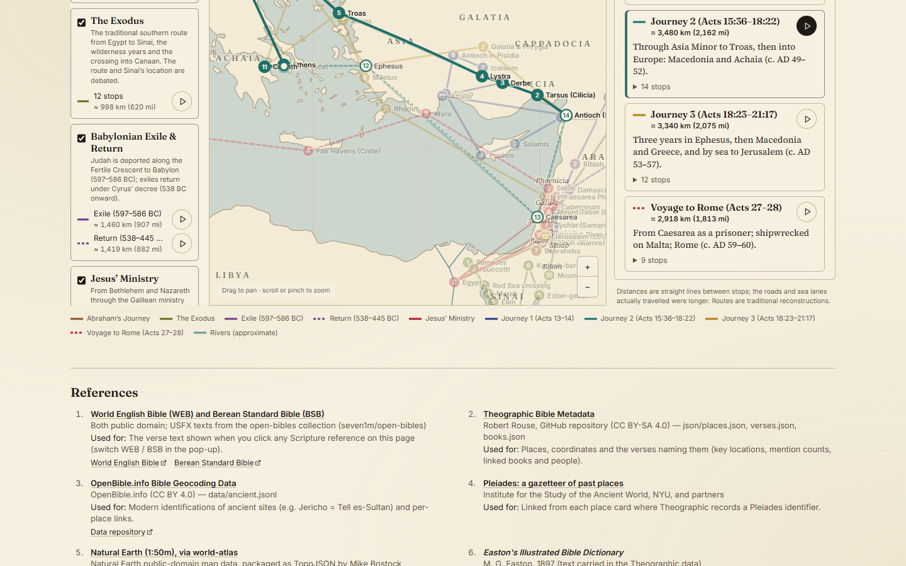
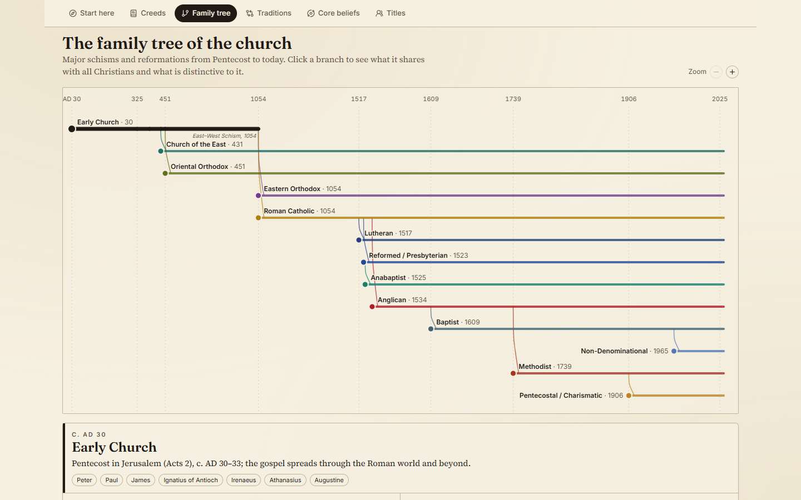
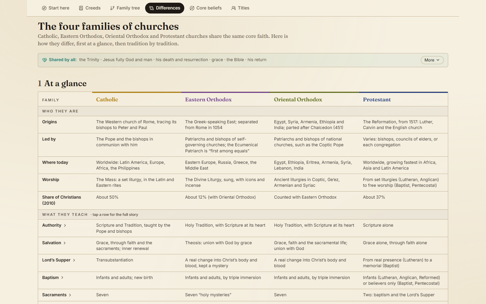
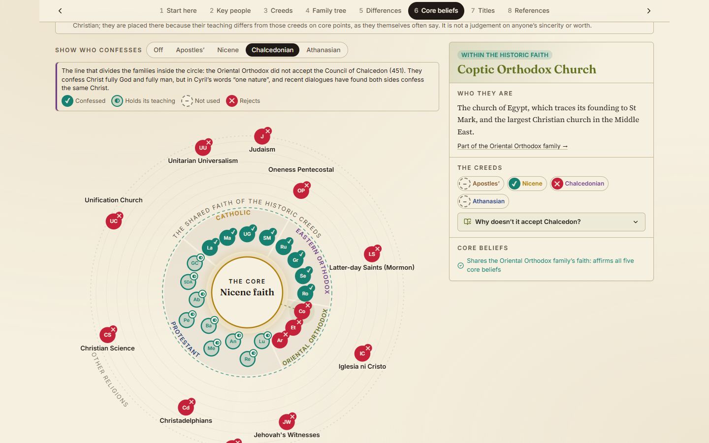
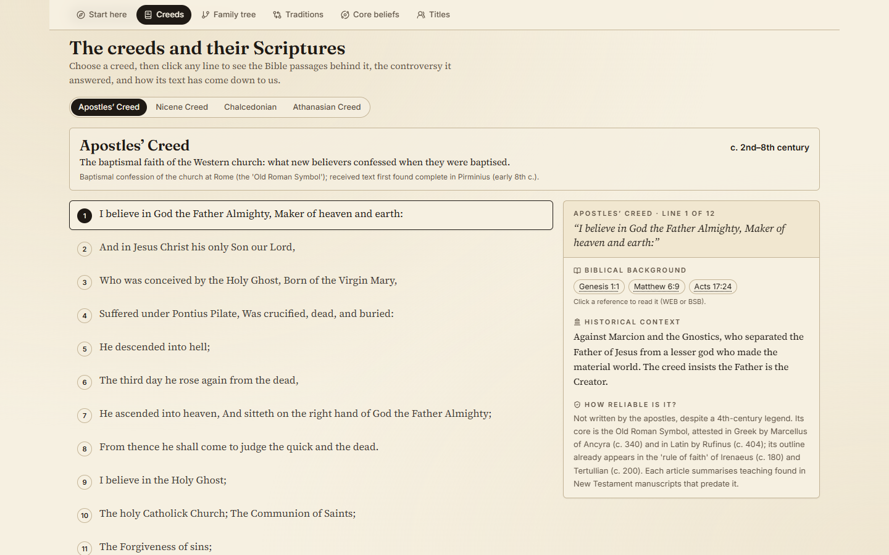
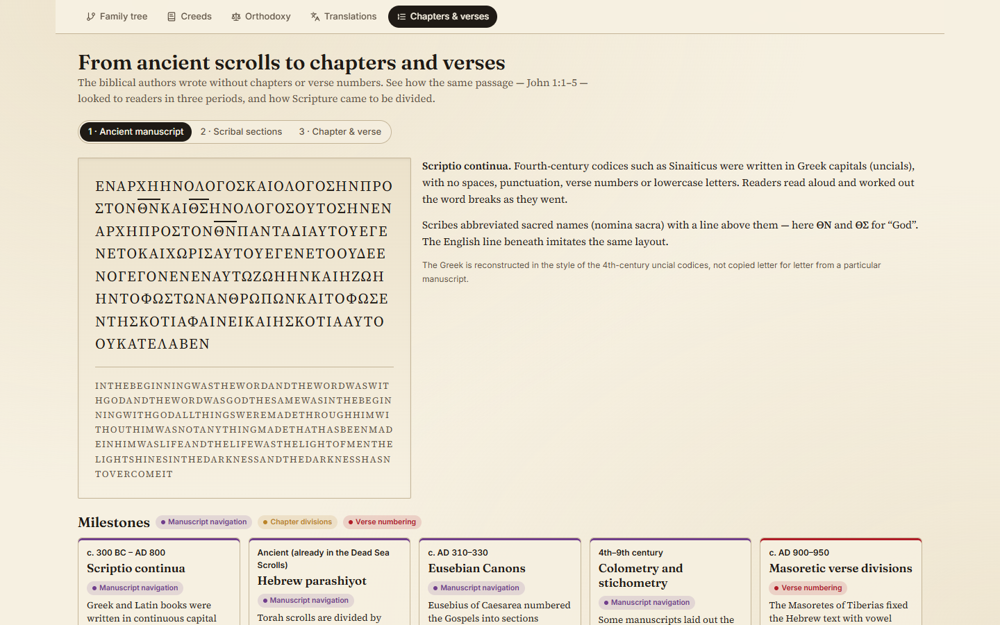
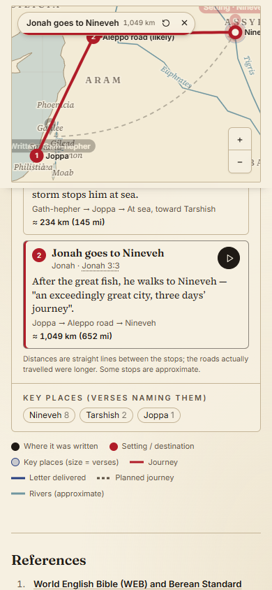

# The Canon Ball

**An interactive guide to the Bible's languages, people and places.**

**▶ Open the site: https://work-kelv.github.io/the-canon-ball/**

It works on phones and computers, in light or dark mode. You can share a link to any page, book or person.



The site opens on an [introduction page](https://work-kelv.github.io/the-canon-ball/) that leads to four sections:

| Page | What you can explore |
|---|---|
| **[The Bible](https://work-kelv.github.io/the-canon-ball/languages.html)** | The text itself: the language each of the 66 books was written in, how scrolls became chapters and verses, and how the Bible was translated. |
| **[Characters](https://work-kelv.github.io/the-canon-ball/characters.html)** | 266 people on one timeline: when they lived, how they are related, and Jesus' line from Adam. |
| **[Map](https://work-kelv.github.io/the-canon-ball/map.html)** | Where each book was written and set, and 129 journeys you can watch on the map. |
| **[Church History](https://work-kelv.github.io/the-canon-ball/history.html)** | How the church branched, how Catholic, Orthodox and Protestant churches differ, the historic creeds and their Scriptures, who stands outside them, and how the Bible was translated and divided into chapters and verses. |

Any Bible reference on the site (shown with a dotted underline) can be clicked to read the verses. You can switch between two translations, the **World English Bible** and the **Berean Standard Bible**.

---

## 1. The Bible

The Bible page follows the text in the order things happened, in three tabs (each with its own link, such as `languages.html#verses`). Its introduction explains why the Bible is in three languages, with a short timeline.

**Original languages.** All 66 books are shown in canonical order. Each one is coloured by its original language, and stronger colour means more chapters.

- **Hebrew and Aramaic books.** Ezra and Daniel are split diagonally to show how much of each is in Aramaic. Genesis and Jeremiah, which have only a few Aramaic words, are marked with a small corner.
- **Book details.** Click any book to see its exact Aramaic passages (for example Daniel 2:4b–7:28), its chapter and verse counts, when it was likely written, and why it used that language.
- **Breakdown.** A second view filters the books by language and shows how the chapters divide between languages and between parts of the Bible.

| Book detail (Daniel) | Breakdown in dark mode |
|---|---|
|  |  |

**Scrolls to chapters & verses.** John 1:1–5 shown three ways: as a 4th-century continuous Greek manuscript, as scribal sense-lines, and with modern chapter and verse numbers. A strip of milestones follows.

**Translations.** From the Septuagint to today's translation work, with figures from Wycliffe's 2025 statistics. You can filter by era and by kind of milestone.

## 2. Characters

There are 266 people, from Adam to the early church. The list includes everyone mentioned in the five books that had no characters before (Jonah, Nahum, Habakkuk, Haggai and 3 John), Jacob's twelve sons, and a per-book checklist of prominent figures. The **Prominent figures only** filter narrows the site to the 209 people named in that checklist.


- **Timeline.** Everyone is placed on one time axis. You can arrange people by when they lived or by book; "By book" puts Ezra and Nehemiah together, for example. Move your mouse across the timeline to see who was alive in a given year.
- **Line of Jesus.** A red line traces all 65 generations from Adam to Jesus.
- **Filters.** Narrow the list by Old or New Testament, era, book, role, or a name search. The timeline zooms to fit whoever is left.
- **Person page.** Click anyone to see a short biography, their dates and how certain they are, which books they appear in, and their relationships. You can jump straight to a related person.
- **Relationship network.** A web of 441 family, mentor, ally and rival relationships.

| Person page (David) | Relationship network |
|---|---|
|  |  |

## 3. Map

The map covers the Mediterranean and the Ancient Near East, drawn in a parchment style with ancient region names. A switch shows modern borders.



- **Books.** Choose any of the 66 books. The map shows where it was likely written, where it is set (or where the letter was sent), and the places it names most often.
- **Journeys in every book.** There are 129 journeys in total; Genesis alone has 13.
  - Each one lists who travelled, the Bible reference, the stops and the distance.
  - Press ▶ to watch it play on the map, or **Play all** to see the journeys one after another.
  - The map stays at the top of the screen while you scroll down the list.
- **Great journeys.** Five major routes, each with a short history:
  - Abraham's journey
  - The Exodus
  - The Babylonian exile and return
  - Jesus' ministry
  - Paul's three missionary journeys and his voyage to Rome
- **Place details.** Click any place to see its modern site and country, a note from Easton's Bible Dictionary, the books that mention it, and the people connected with it.

| Great journeys (Paul's 2nd journey) | Click a reference to read it |
|---|---|
|  |  |

## 4. Church History

The Church History page has five tabs. Each tab has its own link (for example `history.html#creeds`). The old `#translations` and `#verses` links now open those tabs on The Bible page.



- **Family tree.** Thirteen traditions on one timeline, from Pentecost to the non-denominational churches. Click a branch to see what it shares with all Christians, what is distinctive to it, and which traditions grew from it.
- **Traditions.** Pick any two of Catholic, Orthodox, Lutheran, Anglican, Reformed, Baptist and Pentecostal to compare them on ten questions, such as authority, salvation, the Lord's Supper, baptism and Mary. Each question shows a spectrum of where all seven traditions sit, and a row of coloured squares sums up where the two agree and differ. The tab opens with the common ground every tradition shares and the worldwide numbers from Pew Research.
- **Creeds.** The Apostles', Nicene, Chalcedonian and Athanasian creeds, line by line, or all four compared: what each added, a clause-by-clause table with each creed's own words, and which churches confess which creed. Each line comes with the Bible passages behind it, the controversy it answered, and a note on how reliable its text is.
- **Core beliefs.** A diagram with the faith of the creeds at its centre. Inside the circle are the four families of churches (Catholic, Eastern Orthodox, Oriental Orthodox, Protestant), each with member churches: the Latin, Maronite, Ukrainian Greek and Syro-Malabar Catholic churches; the Russian, Greek, Serbian and Romanian Orthodox; the Coptic, Ethiopian and Armenian churches; and the Lutheran, Reformed, Anglican, Methodist, Baptist, Pentecostal, Anabaptist and Adventist families (with Grace Communion). Movements whose teaching differs sit beyond the circle, farther out the more of five core beliefs they set aside. A creed lens shows who confesses the Apostles', Nicene, Chalcedonian or Athanasian Creed. Below it, a detailed table compares six benchmarks across historic orthodoxy, 4th-century Arianism, Jehovah's Witnesses, Latter-day Saints, Oneness Pentecostalism and Christian Science.
- **Titles.** Who's who from pope to pastor: a ladder of titles for each of the four families used on Core beliefs (Catholic, Eastern Orthodox, Oriental Orthodox, and Protestant with its Anglican, Lutheran, Presbyterian, Methodist and Baptist/Pentecostal branches), and a card for each title (its original-language meaning, where it is used, Scripture, and sources such as the Code of Canon Law, the Catechism, the Rule of St Benedict and Crockford's Clerical Directory).

| | |
|---|---|
|  |  |
|  |  |

## On a phone

On a phone the timeline turns vertical, and the map stays pinned to the top while you read.

| Timeline | Map |
|---|---|
|  |  |

---

## Sources

Each page ends with its own reference list. Wikipedia is not used as a source; the site relies on the primary texts and the datasets below.

| Source | Used for | Licence |
|---|---|---|
| [Theographic Bible Metadata](https://github.com/robertrouse/theographic-bible-metadata) | People, family links, places, and the verses they appear in | CC BY-SA 4.0 |
| [OpenBible.info Geocoding](https://www.openbible.info/geo/) | Modern names for ancient sites | CC BY 4.0 |
| [World English Bible and Berean Standard Bible](https://github.com/seven1m/open-bibles) | The verse text in the pop-ups | Public domain |
| [Sefaria](https://www.sefaria.org/texts/Tanakh) and the [SBL Greek New Testament](https://sblgnt.com/) | The Hebrew and Aramaic passages and Greek words cited on the Languages page | — |
| [Pleiades](https://pleiades.stoa.org/) | Gazetteer links on place cards | — |
| [Natural Earth](https://www.naturalearthdata.com/), via [world-atlas](https://github.com/topojson/world-atlas) | Coastlines and modern borders | Public domain |
| [Schaff, *The Creeds of Christendom*](https://www.ccel.org/ccel/schaff/creeds1) and [*History of the Christian Church*](https://www.ccel.org/ccel/schaff/hcc3) | Creed texts and church history | Public domain |
| [Wycliffe Global Alliance statistics](https://www.wycliffe.net/resources/statistics/) | Bible translation figures (2025) | — |
| [Bible-kjv](https://github.com/aruljohn/Bible-kjv) | Book order and chapter and verse counts | — |

**Notes on accuracy**
- **Dates.** The dates come from Theographic, which largely follows Archbishop Ussher's 17th-century chronology (Creation in 4004 BC). Modern scholars date many events differently.
- **Uncertain dates and places.** Where a date or location is uncertain, the site says so.
- **Editorial content.** Character summaries, where each book was written and set, the journey routes and the journey histories were written for this site, and their notes flag debated points.
- **Distances.** Distances are straight lines between stops. The roads and sea routes actually travelled were longer.
- **Licence of the data files.** The data files built from Theographic (`src/data/biblicalCharacters.json` and `src/data/bibleGeography.json`) are shared under the same CC BY-SA 4.0 licence.

---

## For developers

Built with React, TypeScript, Vite, Tailwind CSS, d3-geo/d3-zoom, react-force-graph-2d and Lucide icons.

```bash
npm install
npm run dev        # http://localhost:5173  (index.html, languages.html, characters.html, map.html, history.html)
npm run build      # type-check + production build into dist/
```

Every push to `main` is published to GitHub Pages by [.github/workflows/deploy.yml](.github/workflows/deploy.yml).

### Rebuilding the data

The JSON files in `src/data/` are generated from the open datasets listed above. Those downloads (about 80 MB) are not kept in the repository.

```bash
# Characters (needs Theographic people.json, verses.json, books.json)
node scripts/characters/build-characters.cjs <theographic-json-dir> src/data/biblicalCharacters.json

# Map (also needs places.json, plus OpenBible's ancient.jsonl)
node scripts/geography/build-geography.mjs <theographic-json-dir> <openbible-data-dir>

# Verse text (WEB and BSB USFX files from seven1m/open-bibles)
node scripts/scripture/build-scripture.mjs eng-web.usfx.xml eng-bsb.usfx.xml
```

The hand-written parts (summaries, relationships, journeys and journey histories) are in `scripts/characters/curated*.cjs` and `scripts/geography/curated*.mjs`.

### Project layout

```
index.html (home) · languages.html · characters.html · map.html · history.html   five pages, each with its own entry in src/
src/App.tsx                               shared header, navigation, theme and references
src/components/                           Languages page
src/components/characters/                timeline, network, directory, person page
src/components/map/                       map, journey animation, book and journey panels
src/components/history/                   family tree, creeds, comparison, translations, chapters & verses
src/components/ScriptureRef.tsx           clickable references with WEB / BSB pop-ups
src/data/                                 generated datasets
scripts/                                  data build scripts and curated content
data-sources/                             per-book character checklist
```
